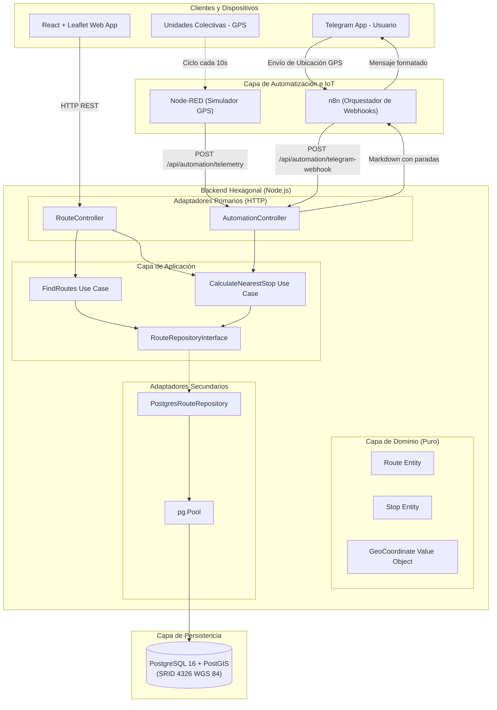

# Tuxtla-Rutas 🚍🗺️
> Sistema de Información Geoespacial (GIS), Monitoreo IoT y Automatización del Transporte Público en Tuxtla Gutiérrez, Chiapas.

[](https://nodejs.org/)
[](https://postgis.net/)
[](https://react.dev/)
[](https://leafletjs.com/)
[](#-arquitectura-del-sistema)

---

## 📌 Descripción General

**Tuxtla-Rutas** es una solución integral diseñada para modernizar la consulta, visualización y monitoreo en tiempo real de rutas, paradas y horarios del transporte colectivo ("combis") en **Tuxtla Gutiérrez, Chiapas**.

El proyecto combina:
- **Geomática Avanzada**: Bases de datos espaciales sobre PostgreSQL con la extensión **PostGIS (SRID 4326 / WGS 84)** para indexación espacial GiST y consultas de proximidad geodésica (`::geography`).
- **Arquitectura Hexagonal**: Núcleo de dominio puro, casos de uso desacoplados y adaptadores primarios/secundarios intercambiables.
- **Visualizador Cartográfico**: Aplicación cliente en **React + Leaflet** con sincronización reactiva y modo de resiliencia offline.
- **Automatización & IoT**: Simulación de telemetría de unidades en tránsito vía **Node-RED** e integración con **Telegram Bot** vía **n8n**.

---

## 🏛️ Arquitectura del Sistema



---

## 🌐 Endpoints de la API REST

| Método | Endpoint | Descripción | Parámetros / Payload |
|---|---|---|---|
| `GET` | `/api/health` | Estado del backend y timestamp del servidor | Ninguno |
| `GET` | `/api/routes` | Obtiene todas las rutas activas con su trazado GeoJSON y paradas ordenadas | Ninguno |
| `GET` | `/api/routes/:id` | Detalle de una ruta específica por su UUID | `id` (parámetro de ruta) |
| `GET` | `/api/stops/nearest` | Encuentra las paradas más cercanas calculando distancia en metros y tiempos de caminata | `lat`, `lng`, `radius` (def: 1500m), `limit` (def: 5) |
| `POST` | `/api/automation/telegram-webhook` | Webhook para n8n / Telegram Bot que procesa ubicación GPS y genera respuesta formateada | `{ lat, lng, userName, chatId }` |
| `POST` | `/api/automation/telemetry` | Receptor de telemetría GPS para unidades en movimiento emitidas desde Node-RED | `{ unitId, routeId, lat, lng, speedKmh }` |
| `GET` | `/api/automation/telemetry` | Consulta las últimas posiciones GPS registradas en memoria de las unidades | `unitId` (opcional), `routeId` (opcional) |

---

## 🚀 Guía de Inicio Rápido (Local)

### 1. Clonar el Repositorio
```bash
git clone https://github.com/LuisMatuss/tuxtla-rutas-app.git
cd tuxtla-rutas-app
```

### 2. Configurar Variables de Entorno (Zero-Trust)
Copia las plantillas seguras a los archivos `.env` locales:
```bash
cp .env.example .env
cp backend/.env.example backend/.env
cp frontend/.env.example frontend/.env
```

### 3. Levantar Infraestructura con Docker Compose
Inicia PostgreSQL + PostGIS, n8n y Node-RED:
```bash
docker compose up -d
```
Verifica que los contenedores estén saludables:
- **PostGIS**: `localhost:5432` (base de datos: `tuxtla_rutas_db`)
- **n8n**: [http://localhost:5678](http://localhost:5678)
- **Node-RED**: [http://localhost:1880](http://localhost:1880)

### 4. Ejecutar el Backend
```bash
cd backend
npm install
npm run dev
# Servidor ejecutándose en http://localhost:3000
```

### 5. Ejecutar el Frontend
En otra terminal:
```bash
cd frontend
npm install
npm run dev
# Aplicación web disponible en http://localhost:5173
```

---

## ☁️ Guía de Despliegue en AWS (Amazon Web Services)

Para un despliegue escalable y seguro en producción en la nube de AWS se recomienda la siguiente arquitectura gestionada:

```
[ Internet / Usuarios ]
         │
         ▼
[ AWS CloudFront (CDN) / Amazon S3 ] ──> Frontend React (Static Hosting)
         │
         ▼
[ AWS Application Load Balancer (ALB) ]
         │
         ▼
[ Amazon EC2 Instance / ECS Fargate ] ──> Backend Node.js Hexagonal
         │
         ▼ (Subnet Privada - VPC)
[ Amazon RDS for PostgreSQL (Multi-AZ) ] ──> PostGIS Extension Activa
```

### 1. Base de Datos: Amazon RDS for PostgreSQL con PostGIS
1. **Creación de Instancia RDS:**
   - Selecciona **PostgreSQL 16**.
   - Asigna una **VPC** con subredes privadas.
   - Habilita cifrado en reposo con **AWS KMS**.
2. **Habilitación de PostGIS en RDS:**
   Conéctate a la instancia RDS con el usuario maestro y ejecuta los scripts de inicialización de [`database/init/`](./database/init/):
   ```sql
   CREATE EXTENSION IF NOT EXISTS postgis;
   CREATE EXTENSION IF NOT EXISTS "uuid-ossp";
   ```
3. **Grupos de Seguridad (Security Groups):**
   - Restringe el puerto `5432` únicamente al grupo de seguridad de las instancias EC2 del backend.

### 2. Cómputo: Amazon EC2 o AWS ECS (Fargate)
1. **Instancia EC2:**
   - SO: Ubuntu Server 22.04 LTS o Amazon Linux 2023.
   - Instala Docker y Docker Compose para correr Node.js, n8n y Node-RED.
2. **Reverse Proxy con Nginx + SSL (Let's Encrypt / ACM):**
   - Configura Nginx para rutear el tráfico `/api` hacia el puerto `3000`.
   - Redirige todo el tráfico HTTP a HTTPS.

### 3. Gestión de Secretos Zero-Trust con AWS Secrets Manager
En lugar de mantener archivos `.env` en el servidor:
1. Almacena las credenciales de base de datos y tokens de Telegram en **AWS Secrets Manager**:
   ```json
   {
     "DB_HOST": "tuxtla-rutas.xxxxx.us-east-1.rds.amazonaws.com",
     "DB_USER": "tuxtla_admin",
     "DB_PASSWORD": "<secreto_generado_en_kms>",
     "DB_NAME": "tuxtla_rutas_db",
     "TELEGRAM_BOT_TOKEN": "<bot_token_telegram>"
   }
   ```
2. Inyecta los secretos al contenedor en el arranque mediante el perfil de rol **AWS IAM**.

---

## 🔒 Política de Seguridad y Blindaje DevSecOps

1. **Sin Fuga de Secretos**: Ningún archivo `.env` o certificado privado se sube al repositorio de control de versiones (`.gitignore` reforzado).
2. **Consultas Parametrizadas**: Todas las consultas PostGIS (`ST_DWithin`, `ST_Distance`) usan marcadores de posición (`$1, $2, $3, $4`) para prevenir inyecciones SQL.
3. **Principio de Mínimo Privilegio**: Conexiones a bases de datos y flujos de automatización operan con credenciales separadas y sin acceso a la consola pública.

---

## 📄 Licencia

Proyecto desarrollado bajo licencia **MIT** para el ecosistema de movilidad urbana de Tuxtla Gutiérrez, Chiapas.
